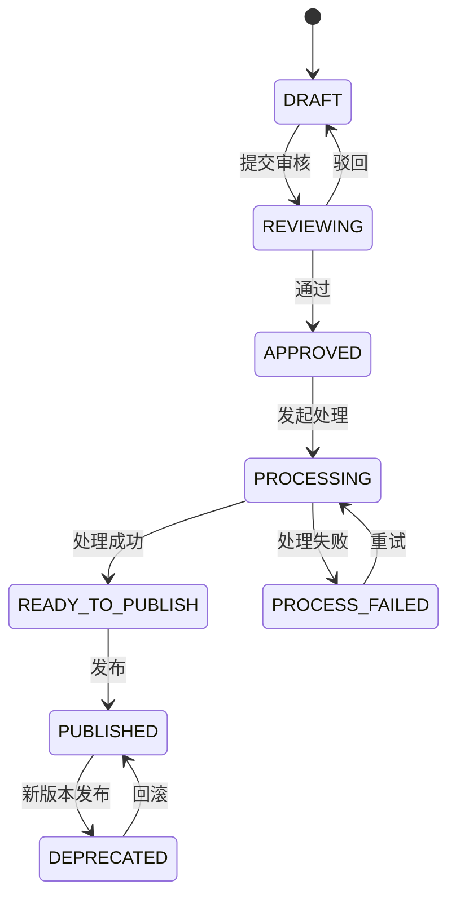

# 知识库运营页面升级方案

> 状态：已被 [知识应用菜单、交互与双壳集成方案](20261017-knowledge-interaction-menu-plan.md) 取代，仅供背景追溯。下文独立版本/切片路由、重复动作入口及下载接口待实现等描述不作为实施依据；以后者的弹窗/抽屉方案、接口核查和验收约定为准。

## 背景

当前 `src/views` 已由代码生成器生成知识分类、标签、主题、版本、切片、任务、发布和回复模板八个表级页面。这些页面适合核对原始数据，但把存储字段直接暴露给使用者，不能体现知识库的实际工作流。

知识服务的业务主线是：维护知识主题和版本，审核原文与标签，异步完成解析、切片、向量化和 Milvus 写入，再发布版本供检索和问答使用。页面升级应在既有 CRUD 之上组合这些领域动作，不重复实现通用 CRUD，也不要求后端提供管理型聚合接口。

## 目标

- 将生成的表级页面升级为可完成知识运营流程的领域页面。
- 保持一个领域动作只调用一个后端能力，由页面负责组合流程。
- 使用现有通用 CRUD 管理基础数据；使用知识服务已有领域接口完成审核、处理、发布、检索和问答。
- 让状态、权限和并发版本成为页面操作的明确前提。
- 在后续实现时更新路由、资源配置和静态权限点，确保独立模式和 qiankun 集成模式可用。

## 非目标

- 不修改知识服务的通用 CRUD 接口，不为当前页面新增管理型聚合接口。
- 不实现发布下线功能；知识服务当前没有对应领域接口。
- 不在浏览器中访问 Docling、Embedding、Milvus、Rerank 或模型服务。
- 不将对象存储路径、解析产物路径、哈希、任务租约、服务商配置或密钥展示给页面用户。
- 本方案不调整生成器，也不替代后续的接口联调和视觉设计。

## 业务状态与页面动作

| 版本状态 | 页面可操作项 | 页面禁止项 |
|---|---|---|
| `DRAFT` | 编辑元数据、编辑 FAQ、替换文件、选择标签、提交审核 | 发起处理、发布 |
| `REVIEWING` | 查看原文、标签、审核意见；审核通过或驳回 | 修改原文、标签、处理、发布 |
| `APPROVED` | 发起处理 | 编辑、发布 |
| `PROCESSING` | 查看任务进度和处理摘要 | 人工创建或编辑任务、发布 |
| `PROCESS_FAILED` | 查看错误摘要、重试 | 发布 |
| `READY_TO_PUBLISH` | 发布 | 修改原文、处理输入 |
| `PUBLISHED` | 查看线上版本和引用效果 | 编辑已发布版本 |
| `DEPRECATED` | 查看历史内容、回滚 | 编辑、重新发布为新版本 |

审核对象是原始文件或 FAQ 内容及其标签，不审核 OCR、解析结果或切片质量。切片和任务页面只用于核对处理结果与定位失败。

## 信息架构与页面清单

### 1. 知识主题页

**建议路由：** `/knowledge-item`。替换现有 `/knowledge_item` 的通用表格体验，旧路由在资源迁移完成前可保留兼容映射。

| 区域 | 内容与操作 |
|---|---|
| 查询区 | 分类、主题名称、知识键、类型、启停状态 |
| 列表 | 名称、分类、类型、状态、当前发布版本、更新时间 |
| 新建/编辑抽屉 | 主题名称、知识键、分类、类型、描述、启停状态 |
| 行内入口 | 版本列表、创建版本、发布中心 |

使用 `KnowledgeItemApi` 的生成 CRUD。`organId`、创建人等审计字段不进入编辑表单。页面内的“创建版本”只做导航或打开版本创建抽屉，不创建新的后端组合接口。

### 2. 知识版本工作台

**建议路由：** `/knowledge-revision`。这是主工作页，以主题为上下文展示其版本，不再暴露通用表字段。

| 区域 | 内容与操作 |
|---|---|
| 主题摘要 | 主题名称、分类、类型、当前线上版本、返回主题列表 |
| 版本列表 | 版本号、来源类型、文件名或 FAQ 问题、标签、状态、切片数、更新时间 |
| 版本编辑 | `FILE` 选择文件并上传；`FAQ` 维护标准问题和答案；两种来源均维护版本号、优先级和标签 |
| 版本详情 | 原文/FAQ 内容、审核信息、处理摘要、切片概览、历史版本列表入口 |
| 状态动作 | 严格按上表显示提交审核、通过、驳回、开始处理等动作 |

创建和编辑版本继续使用 `KnowledgeRevisionApi.save`。文件版本创建后通过 `replace-file` 上传文件；不能让用户填写文件存储路径、文件摘要、解析器字段、向量模型或索引完成时间。

`save` 仅返回版本 ID，不返回版本对象。创建/保存完成后先通过 `/list` 按 ID 重新查询，取得当前 `version`，再进行上传或审核；具体顺序见下文“保存返回值与按 ID 查询”。

### 3. 审核工作台

**建议路由：** `/knowledge-review`。面向审核角色，按 `REVIEWING` 状态筛选版本。

| 区域 | 内容与操作 |
|---|---|
| 待审列表 | 主题、版本、来源类型、提交人、提交时间、标签、优先级 |
| 原文查看 | 文件来源提供“下载原文件”，审核员在本地打开；FAQ 来源直接展示问题与答案 |
| 标签审核 | 显示标签名称与编码，审核员判断是否准确 |
| 审核动作 | 通过、驳回；驳回意见为必填，成功后刷新列表和版本详情 |

审核页只调用版本领域动作，不在前端创建审核记录表：

- `POST /knowledge/knowledge_revision/review/submit`
- `POST /knowledge/knowledge_revision/review/approve`
- `POST /knowledge/knowledge_revision/review/reject`

三个请求均传 `revisionId` 与最新 `expectedVersion`；驳回额外传 `comment`。页面操作前应重新读取或从当前列表行取得版本号，冲突后提示刷新。

文件原文统一下载，不实现在线预览或格式转换。新增后端接口的服务内路径为 `GET /knowledge_revision/{revisionId}/source/download`，按当前 App 的 Gateway 前缀规则调用 `GET /knowledge/knowledge_revision/{revisionId}/source/download`。

前端通过现有认证 HTTP 客户端按二进制响应下载，由浏览器保存附件；文件名取自服务端附件响应头。下载辅助代码应释放临时对象 URL。不能将下载响应按 `Result` JSON 解包，也不能用上传者浏览器中保留的临时文件代替服务端原文件；前端 API 需要处理 JSON 错误响应，下载失败时保留当前审核界面。

**文件审核验收阻塞项：** 原文件下载接口尚待后端实现，完成前不得宣称文件审核流程可完整交付。FAQ 审核可以独立开发和验收。接口能力缺失或下载失败时明确提示原因，不要求审核员在无法读取原文时完成审核；下载成功也不自动触发审核或记录为内容已审核。后端具体方案见 [RQ-006：原文件受控下载](../../../g2rain-knowledge/docs/requirements/RQ-006-knowledge-source-download.md)。

### 4. 处理任务中心

**建议路由：** `/knowledge-task`。由现有任务表页面改为运行监控页。

| 区域 | 内容与操作 |
|---|---|
| 查询区 | 主题、版本、任务状态、开始/完成时间 |
| 列表 | 任务号、主题/版本、任务类型、状态、尝试次数、开始/完成时间、错误摘要 |
| 详情抽屉 | 安全错误码、错误摘要、关联版本状态、切片数量、索引状态 |
| 操作 | `APPROVED` 版本可开始处理；失败任务可重试；待执行任务可取消 |

页面不得提供手工新增、编辑或删除任务。任务由处理动作创建：

- `POST /knowledge/knowledge_task/process/{revisionId}`
- `POST /knowledge/knowledge_task/retry`
- `POST /knowledge/knowledge_task/cancel`

处理中每 5 至 10 秒轮询任务列表及关联版本状态；离开页面、切换主题或组件卸载时停止轮询。运行中取消属于后端协作能力，当前页面仅在接口返回可取消状态时显示取消按钮。

### 5. 切片核对页

**建议路由：** `/knowledge-chunk`，也可作为版本详情内的 Tab。

切片页用于处理完成后的可观测性：展示块序号、标题路径、页码范围、Token 数、状态。默认按版本打开，仅保留版本与状态筛选。禁止显示 `sourceLocator`、内容哈希和存储地址；不提供新增、编辑、删除。

### 6. 发布中心

**建议路由：** `/knowledge-release`。以知识主题为维度展示当前线上版本与历史版本。

| 区域 | 内容与操作 |
|---|---|
| 当前发布信息 | 读取 `knowledge_release`，展示主题、当前生效版本、最近发布时间、发布人、发布说明 |
| 可发布版本 | 仅展示 `READY_TO_PUBLISH` 的版本，可填写发布说明后发布 |
| 历史版本列表 | 读取 `knowledge_revision`，展示历史版本的版本号、来源类型、文件名、状态、创建时间、更新时间；`DEPRECATED` 版本提供回滚操作 |
| 结果反馈 | 发布/回滚完成后刷新主题、当前发布信息和版本列表 |

发布选择记录使用现有 `KnowledgeReleaseApi` 生成 CRUD 查询和初始化；实际状态转换仅调用：

- `POST /knowledge/knowledge_release/publish`
- `POST /knowledge/knowledge_release/rollback`

发布与回滚请求都需要 `releaseId`、`revisionId`、`expectedReleaseVersion`、`expectedRevisionVersion`，可选 `reason`。页面不创建“下线”按钮。

`knowledge_release` 只保存当前生效版本及最近一次发布信息，后续发布或回滚会覆盖这些字段；`knowledge_revision` 不保存每次发布的人员、时间和原因。因此历史版本列表不展示原发布时间、原发布人或原发布说明，也不以版本的创建/更新时间代替发布时间。对于 FAQ 来源，文件名列显示“—”，可展示现有 FAQ 问题字段作为内容摘要。

本次不新增发布历史表、发布审计或历史查询接口。回滚使用已有接口，成功后刷新当前发布信息和版本列表，不额外记录发布审计。

### 7. 检索与问答验证页

**建议路由：** `/knowledge-search`。这是运营验证工具，不替代最终面向业务用户的问答入口。

| 区域 | 内容与操作 |
|---|---|
| 检索表单 | 问题、全部匹配标签、任一匹配标签、`topK` |
| 检索结果 | 是否可回答、原因码、主题、版本、章节、页码、证据文本、得分 |
| 问答表单 | 在检索条件上选择启用的回复模板并请求回答 |
| 问答结果 | 模型回答与可点击/可展开的证据引用 |

调用接口：

- `POST /knowledge/retrieve`
- `POST /knowledge/answer`

`/answer` 在检索、重排序后按 `templateCode` 取得启用模板，再调用模型。模板编码不是模型名称。无证据时显示服务端返回的不可回答结果，不在浏览器中补造答案。

### 8. 基础配置页

保留生成页面，但优化表单字段和列表列：

| 页面 | 保留的业务字段 | 约束 |
|---|---|---|
| 知识分类 | 名称、编码、排序、状态、说明 | 分类删除前由后端校验关联数据 |
| 知识标签 | 名称、编码、状态、说明 | 编码创建后视为稳定检索条件 |
| 回复模板 | 模板编码、名称、系统提示词、状态、说明 | 至少维护一个启用的 `DEFAULT` 模板 |

回复模板使用已生成 CRUD。系统提示词是运营配置，编辑页需要展示长度限制、启停影响和预览，不在页面中填写模型服务地址或模型名称。

## 页面与接口契约

后续在各页面同目录的 `api.ts` 中补充领域方法，在 `type.ts` 中定义最小请求和响应类型；不要把服务端 PO 的全部字段复制进编辑 Payload。

### 保存返回值与按 ID 查询

现有后端通用 `/save` 返回 `Result<Long>`。前端 HTTP 封装读取 `res.data` 后得到的是 ID，不能继续声明为完整领域对象，更不能从保存结果中直接读取 `id` 或 `version`。

- 将现有各模块 `save` 的返回类型、HTTP 泛型、注释和 Mock 统一为 ID 契约；ID 的 TypeScript 类型须与 G2rain 实际 JSON 序列化及精度策略一致，本方案不单独假定 `Long` 一定可安全转换为 `number`。
- 后端没有生成 `GET /knowledge_revision/{id}` 详情接口。前端 `KnowledgeRevisionApi.getById` 应改为调用现有 `list({ id })` 的适配方法；相关主题、任务、发布等模块如存在同类无后端对应的详情请求，也按真实接口修正。
- 版本查询使用 `GET /knowledge/knowledge_revision/list?id=<revisionId>`。API 层要求返回且仅返回一条匹配记录，再将它作为版本详情返回；无记录时提示数据不存在或不可访问，停止后续操作，不构造默认版本对象。
- 不为此新增后端详情接口，不改变后端保存返回结构，也不依赖列表行缓存或前端递增值推算最新 `version`。

### 文件保存、上传与审核的调用顺序

1. 调用 `KnowledgeRevisionApi.save(payload)`，取得 `revisionId`；编辑时同样使用返回 ID。
2. 调用 `KnowledgeRevisionApi.getById(revisionId)`，其内部使用 `/list?id=...`，取得当前版本详情与 `version`。
3. 如需上传文件，调用 `POST /knowledge/knowledge_revision/{revisionId}/replace-file`，以步骤 2 的 `version` 作为 `expectedVersion`，同时提交 `file`。
4. 上传成功后再次按 ID 查询版本，刷新文件元数据、状态和 `version`。上传前的版本号不能继续用于提交审核。
5. 提交审核时使用最近读取的 `revisionId` 和 `version`。如果用户稍后再操作，先重新查询并检查状态；审核通过、驳回等动作同样遵循该规则。
6. 每次领域动作成功后重新查询详情和相关列表。发生版本冲突时保留用户输入，刷新服务端数据并提示重新操作，不自动重放上传或审核请求。

FAQ 不需要文件上传：保存后按 ID 查询版本，再使用查得的 `version` 提交审核。保存成功但后续查询或上传失败时，保留已创建的 `revisionId`，允许重新查询或重试上传，不重新创建一条版本记录。

任务重试/取消使用按任务 ID 查询得到的任务 `version`；发布/回滚分别读取发布选择和目标版本的最新 `version`，不能把版本记录的 `version` 当作任务或发布选择的版本号。

### 领域动作请求

| 页面能力 | API 方法建议 | 请求要点 |
|---|---|---|
| 替换文件 | `KnowledgeRevisionApi.replaceFile` | `revisionId`、`file`、`expectedVersion`，`multipart/form-data` |
| 下载原文件 | `KnowledgeRevisionApi.downloadSource` | `revisionId` 为 URL 参数；认证 GET 返回附件二进制流，无需 `expectedVersion` |
| 提交审核 | `KnowledgeRevisionApi.submitReview` | `revisionId`、`expectedVersion` |
| 通过/驳回 | `KnowledgeRevisionApi.approveReview` / `rejectReview` | 驳回带 `comment` |
| 发起处理 | `KnowledgeTaskApi.process` | `revisionId` 为 URL 参数 |
| 重试/取消 | `KnowledgeTaskApi.retry` / `cancel` | `taskId`、`expectedVersion` |
| 发布/回滚 | `KnowledgeReleaseApi.publish` / `rollback` | 双版本乐观锁与可选 `reason` |
| 检索/问答 | `KnowledgeSearchApi.retrieve` / `answer` | `query`、标签条件、`topK`；问答增加 `templateCode` |

所有专用动作依赖登录态确定组织边界。页面不发送或编辑 `organId`，也不能根据接口异常文本推断权限、状态或业务分支。

## 路由、权限与资源配置规划

当前 `route-map.ts` 和资源 JSON 仅登记生成表页面，按钮权限也只有 `add`、`edit`、`delete`。实现时按以下原则升级：

| 页面 | 需新增或调整的静态权限点 |
|---|---|
| 主题与版本 | `knowledge_item:view`、`knowledge_revision:view`、`knowledge_revision:submit-review`、`knowledge_revision:replace-file` |
| 审核 | `knowledge_revision:review-approve`、`knowledge_revision:review-reject` |
| 处理 | `knowledge_task:view`、`knowledge_task:process`、`knowledge_task:retry`、`knowledge_task:cancel` |
| 发布 | `knowledge_release:view`、`knowledge_release:publish`、`knowledge_release:rollback` |
| 检索问答 | `knowledge_search:retrieve`、`knowledge_search:answer` |
| 字典与模板 | 保留生成的 CRUD 权限；模板增加 `knowledge_answer_template:view` |

权限表达式必须使用静态 `v-permission="'namespace:action'"`，再运行 `npm run build:config` 生成资源配置。路由采用静态 `route-map.ts` 注册，所有新的 `linkPath` 必须与资源页配置一致。

## 实施顺序

1. **契约整理**：修正通用保存的 ID 返回类型及 Mock，将没有后端对应接口的 `getById` 改为 `/list` 按 ID 查询适配；为版本、任务、发布、检索/问答补齐最小前端类型和 API 方法，删除编辑表单中的内部字段。组织填充与默认值依赖 knowledge 服务的保存接口升级方案，本项查询与返回类型修正不新增后端接口。
2. **基础配置**：升级分类、标签、回复模板页面，建立可用于后续流程的选择器数据源。
3. **主题与版本**：完成主题页、版本工作台、文件上传和 FAQ 编辑；落实状态驱动的按钮可见性。
4. **审核与处理**：先完成 FAQ 审核；后端下载接口就绪后完成文件下载与文件审核验收，再完成任务中心、切片核对和轮询清理逻辑。
5. **发布**：完成发布候选、历史版本与回滚页面，处理双版本乐观锁冲突。
6. **验证工具**：完成检索与问答验证页，并展示证据引用。
7. **资源与联调**：登记路由、静态权限点和资源配置，连接 Gateway 与真实服务，完成双运行模式验证。

## 交互与错误处理规则

- 所有改变状态的操作先给出业务后果明确的确认提示；成功后刷新当前主题、版本、任务或当前发布信息。
- 收到并发版本冲突时，保留用户输入、提示数据已变化并要求刷新后重新操作。
- 任务失败只展示后端已净化的错误摘要和错误码，不渲染任务快照、调用链、提供方凭据或原文。
- 文件上传只接受服务端支持的文件类型和大小；页面校验用于减少无效提交，服务端校验仍为最终依据。
- 页面不根据轮询自行改变版本状态，始终以服务端返回状态为准。
- 组件中的定时器、请求取消控制和 Watcher 必须在 `onUnmounted` 时清理，兼容 qiankun 多实例卸载。

## 验收条件

1. 运营人员可从主题开始完成“创建版本 → 上传/编辑原文 → 提交审核 → 审核 → 处理 → 发布”的完整流程。
2. 审核页只展示原文与标签审核能力，不出现 OCR 或切片人工审核动作。
3. 任务、切片、发布页面均不允许手工篡改后端内部状态或处理参数。
4. 历史 `DEPRECATED` 版本可以通过发布中心回滚，未提供不存在的下线操作。历史版本列表仅使用版本已有字段，不展示无数据来源的历史发布人、发布时间和说明；发布或回滚后正确刷新当前发布信息。
5. 检索与问答页能展示不可回答状态、最终回答和可信引用来源。
6. `organId`、文件/解析存储路径、服务配置和密钥均不出现在可编辑或可见区域。
7. 新页面与按钮权限已登记到 `route-map.ts` 和资源生成结果，独立模式与 qiankun 集成模式均可访问和卸载。
8. 保存只读取返回 ID，详情通过 `/list?id=...` 获取；不存在对未实现的 `GET /{id}` 的请求。文件上传后重新读取 `version` 再提交审核，无记录或版本冲突时停止后续动作。
9. Mock 的保存响应为 ID、按 ID 列表响应为数组；通过真实接口核对 JSON 类型与乐观锁版本。保存成功后的查询/上传失败不会引发重复创建版本。
10. 审核员可在自己的登录会话中下载服务端原文件并在本地查看；不依赖上传者临时文件，不暴露存储路径。文件审核完整验收以真实下载接口就绪为前提，FAQ 审核可单独验收。

## 依赖与联调前提

- 知识服务已部署并经 Gateway 暴露 `/knowledge` 路径。
- 文件审核必须先实现受控原文件下载接口；页面只下载附件，不提供在线预览，不将存储路径作为可访问 URL。
- 处理、检索和问答联调依赖服务端正确配置 Docling、Embedding、Milvus、Rerank 与模型服务。
- `DEFAULT` 回复模板必须存在且处于启用状态，否则未指定 `templateCode` 的问答无法生成回答。
